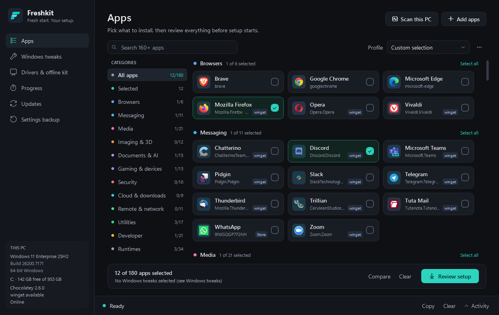
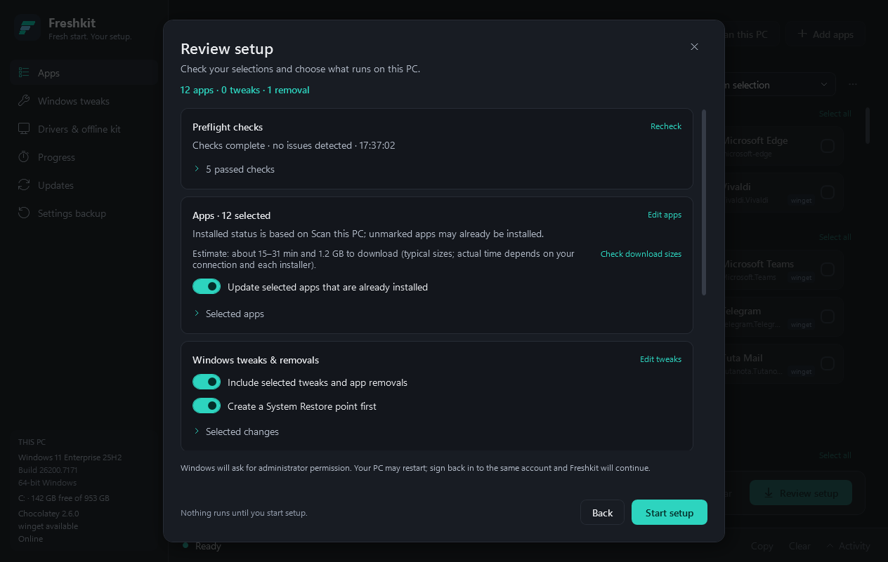
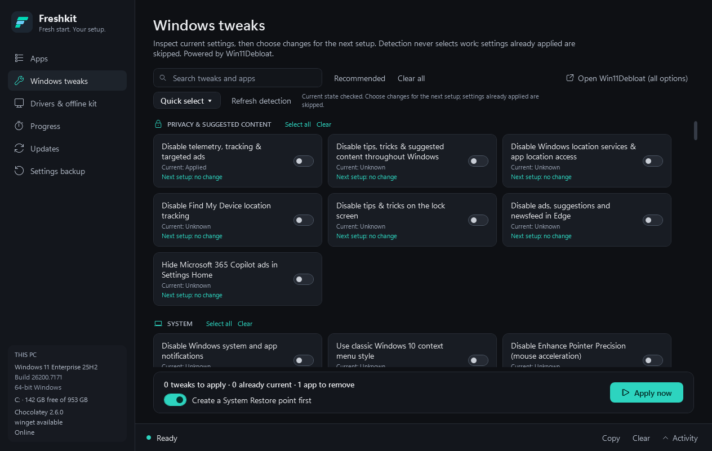
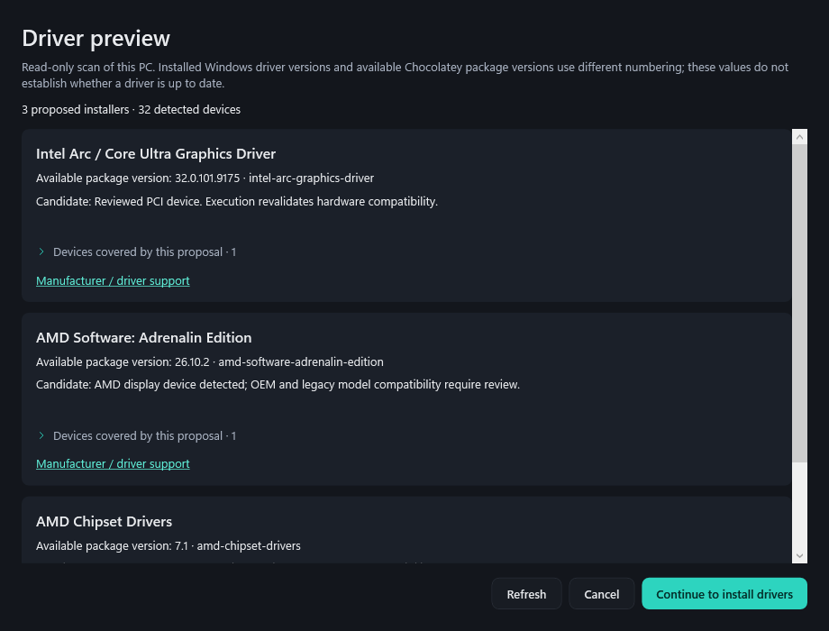
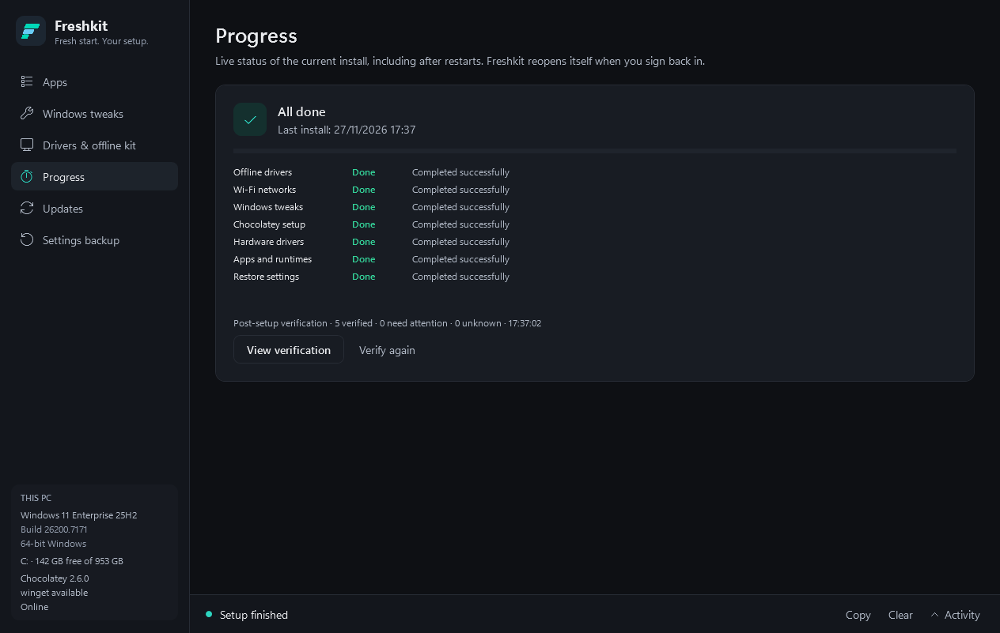
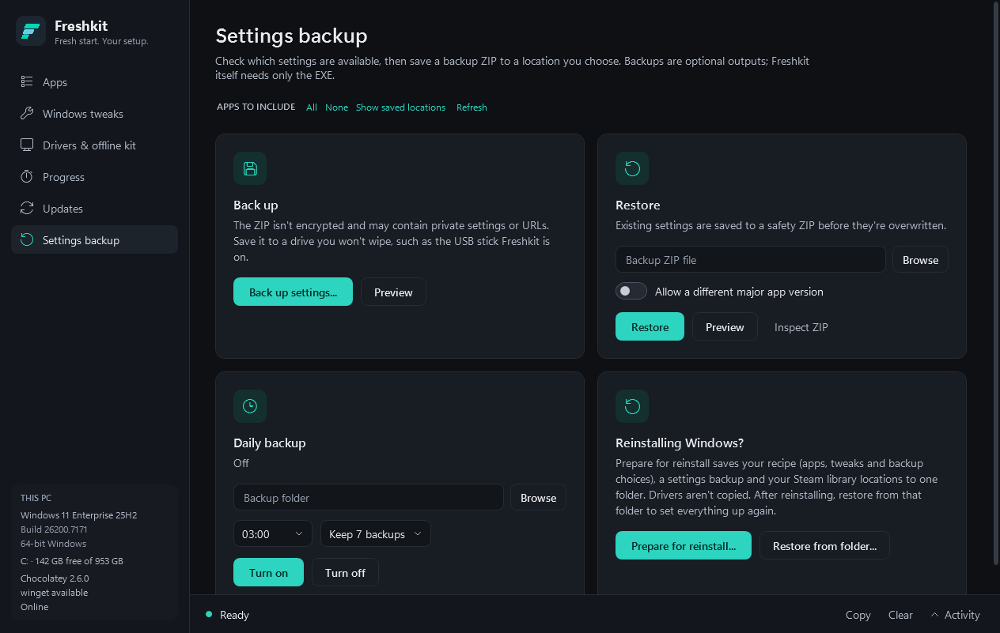
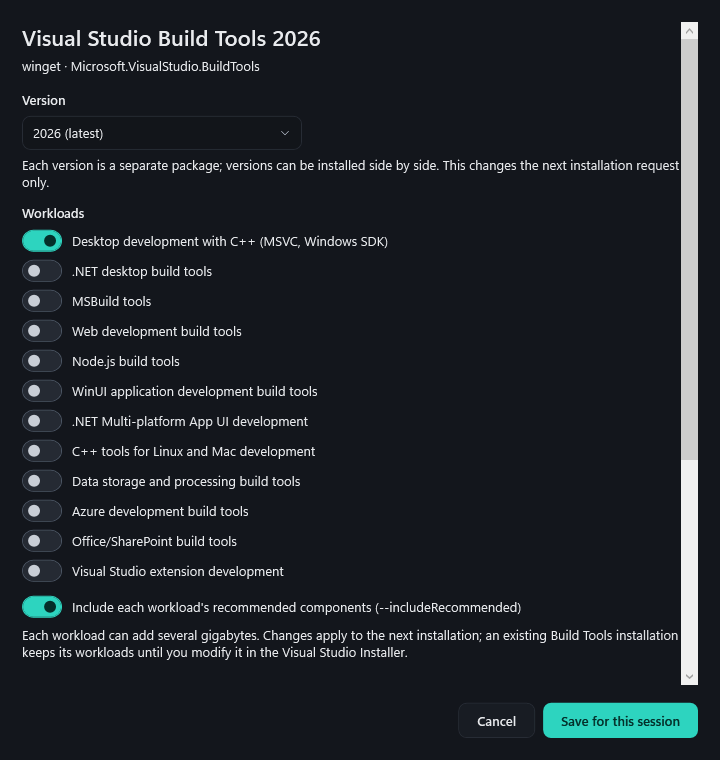

# Freshkit

**Fresh start. Your setup.** Freshkit sets up a new or reinstalled Windows 11 PC in one go: apps, drivers, Windows tweaks and your app settings. It's a single portable EXE, so it runs from any folder or a USB stick with nothing to install.



## Download

Get `Freshkit.exe` from [Releases](https://github.com/minimalhandle/Freshkit/releases) and run it.

- Windows 11 (x64), an administrator account and an internet connection for installing apps.
- The EXE isn't code-signed yet, so Windows SmartScreen may warn the first time. Choose **More info → Run anyway**.

## What it does

- **Apps:** 180 popular apps, with nothing ticked to start. Pick your own, or start from a starter profile (essentials, gaming, developer, office & family). **Add apps** searches winget, Chocolatey, the Microsoft Store and GitHub releases. Apps that need another app (such as OpenRGB plugins) tick it for you.
- **Installation options:** right-click an app to choose its language, version (e.g. Visual Studio Build Tools 2026/2022/2019, Python 3.x) or Build Tools workloads.
- **Windows tweaks:** privacy, AI and interface settings and removal of preinstalled apps, powered by [Win11Debloat](https://github.com/Raphire/Win11Debloat). It shows each setting's current state, and you can create a restore point first.
- **Drivers:** detects NVIDIA, AMD and Intel graphics and AMD chipsets and shows what it will install before it starts. It can also save an offline driver and Wi-Fi kit for PCs without a network driver.
- **Review before anything runs:** readiness checks, a time and download estimate, and a summary of every change.
- **Progress that survives restarts:** setup continues after a restart, failed items can be retried, and installed apps are verified when it finishes.
- **Updates:** checks winget, Chocolatey, Store and GitHub apps for updates, with optional weekly automatic updates.
- **Settings backup:** backs up and restores settings for supported apps (Firefox, OBS, Stream Deck, Playnite and more), with optional daily backups.
- **Reinstalling Windows:** saves your setup, settings and Steam library locations to one folder, then restores them afterwards.
- **Recipes:** save your whole setup as a file and reuse it on any PC, compare it with a PC, or export it for `winget import` / Chocolatey.

| | |
|---|---|
|  |  |
|  |  |
|  |  |

## Where to find things

| To… | Go to |
|---|---|
| Save, load or compare a recipe, or export for winget/Chocolatey | **Apps → ⋯** (next to Profile) |
| Change an app's language, version or options | Right-click the app |
| Prepare for or restore after a Windows reinstall | **Settings backup**, or **Apps → ⋯** |
| Turn on daily settings backups | **Settings backup → Daily backup** |
| Turn on weekly app updates | **Updates** |
| Create or use an offline driver kit | **Drivers & offline kit** |

## Good to know

- Run Freshkit from the account you're setting up. Windows may restart during setup; sign back in to the same account and Freshkit carries on. Keep the EXE (or USB stick) in the same place until it finishes.
- Freshkit remembers nothing between sessions unless you export a recipe. It never writes files next to the EXE.
- Logs from a setup are kept in `%LOCALAPPDATA%\Freshkit` until you delete them on **Progress**. Backup ZIPs and kits go only where you choose. Wi-Fi exports contain passwords in plain text.

## Command line

```
Freshkit.exe Install setup.freshkit.json   # install a recipe's apps unattended
Freshkit.exe Plan setup.freshkit.json      # preview without installing
Freshkit.exe /?                            # all commands
```

## More

- [Technical reference](docs/technical-reference.md): catalog format, backup rules, limits and building from source
- [Driver support](docs/driver-support.md)
